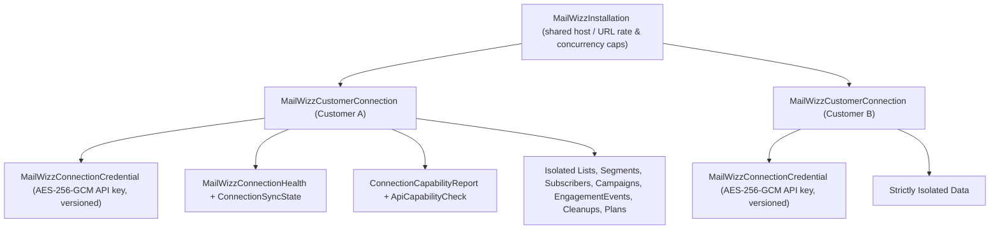

# Multi-Customer MailWizz API Architecture (Phase 4)

## 1. Architectural Overview

Phase 4 transforms **MailWizz List Hygiene Manager** from a single-tenant configuration (`AppConfig` singleton) into a multi-customer SaaS-grade hygiene and deliverability platform supporting multiple independent MailWizz customer accounts on **one or multiple MailWizz installations** (e.g., multiple customer API keys sharing `https://app.nohitchweb.com/api/index.php` as well as separate MailWizz instances).

Every tenant-owned dataset, API client instance, background worker job, webhook ingestion event, compatibility verification, hygiene cleanup plan, re-engagement workflow, report export, and audit trail is strictly scoped to a `MailWizzCustomerConnection` ID. Global cross-tenant fallbacks are disabled fail-closed whenever tenant identity cannot be unambiguously resolved.

---

## 2. Database Schema & Tenant-Scoped Constraints

Defined in [prisma/schema.prisma](file:///E:/MyCodes/MailWizz%20List%20Hygiene%20Manager/prisma/schema.prisma) and applied via [migration.sql](file:///E:/MyCodes/MailWizz%20List%20Hygiene%20Manager/prisma/migrations/20261116000000_phase4_multi_customer_connections/migration.sql):

### Core Multi-Customer Models
- **`MailWizzInstallation`**: Represents a MailWizz host/base URL (`baseUrl` unique, `hostname`, `maxRequestsPerSecond`, `maxConcurrentJobs`, `detectedVersion`, `approvedVersion`, `isActive`). Automatically shared across customers targeting the same base URL.
- **`MailWizzCustomerConnection`**: Represents one customer API account (`customerName`, `customerSlug` unique, `installationId`, `authMode`, encrypted `webhookSecretEnc` + `webhookSecretLast4`, encrypted `reportingDbUrlEnc`, `reportingDbPrefix`, `isEnabled`, `isPrimary`, `isQuarantine`, `isDemoData`, `status: ConnectionStatus`, `detectedVersion`, `approvedVersion`, `maxRequestsPerSecond`, `syncScheduleCron`, `syncScheduleEnabled`).
  - `ConnectionStatus`: `PENDING | CONNECTED | AUTH_FAILED | DISABLED | LEGACY_QUARANTINE`.
- **`MailWizzConnectionCredential`**: Stores encrypted customer API keys (`apiKeyEnc`, `apiKeyLast4`, `apiKeyFingerprint`, `status: CredentialStatus`, `isActive`, `version`, `rotatedFromId`, `revokedReason`, `createdByEmail`, `rotatedAt`, `revokedAt`, `lastUsedAt`).
  - Partial unique index `MailWizzConnectionCredential_one_active_per_conn` (`WHERE "isActive" = true`) guarantees at most one active credential per customer connection.
- **`MailWizzConnectionHealth`**: Per-customer probe status (`lastCheckedAt`, `lastSuccessAt`, `lastErrorAt`, `lastStatusCode`, `lastLatencyMs`, `lastEndpointTested`, `lastErrorSafe`, `detectedVersion`, `verifiedAuthMode`, `consecutiveFailures`, `totalRequestsCount`, `totalErrorsCount`).
- **`ConnectionSyncState`**: Per-customer worker pause/resume state (`isPaused`, `pauseReason`, `pausedByEmail`, `pausedAt`, sync watermarks, active counters).
- **`ConnectionCapabilityReport`**: Per-customer historical compatibility assessment snapshots (`adapterMode`, `overallStatus`, `readOnlySafe`, `autoCleanupAllowed`, `mutationSafetyAllowed`, `mutationLockReason`, `approvedVersion`, `approvedByEmail`, `warningsJson`, `reportJson`).

### Composite Tenant Uniqueness Constraints
Two customers on the same MailWizz installation can own lists/campaigns/subscribers with identical MailWizz UIDs or email addresses without collision:
- `MailingList`: `@@unique([customerConnectionId, listUid])` (replaces global `listUid` uniqueness).
- `Campaign`: `@@unique([customerConnectionId, campaignUid])` (replaces global `campaignUid` uniqueness).
- `Subscriber`: `@@unique([customerConnectionId, mailingListId, subscriberUid])`.
- `ApiCapabilityCheck`: `@@unique([customerConnectionId, capabilityKey])` (replaces global `capabilityKey` uniqueness).
- `ListSegment`, `EngagementEvent`, `CleanupOperation`, `CleanupOperationRecord`, `ReengagementPlan`: required non-null `customerConnectionId` foreign keys with `ON DELETE CASCADE`.
- `SyncJob` and `AuditLog`: nullable `customerConnectionId` (`ON DELETE SET NULL`) plus `SyncJob.credentialVersion` to support both system-level audit events and tenant-scoped operational jobs.

---

## 3. API Client Factory & Per-Installation / Per-Customer Throttling

Implemented in [`src/services/mailwizz/client-factory.ts`](file:///E:/MyCodes/MailWizz%20List%20Hygiene%20Manager/src/services/mailwizz/client-factory.ts) and [`src/services/mailwizz/connections.ts`](file:///E:/MyCodes/MailWizz%20List%20Hygiene%20Manager/src/services/mailwizz/connections.ts):

- **`getMailWizzClientWithContext(customerConnectionId, options)`**:
  - Fails closed if the connection does not exist, has `isQuarantine = true`, `isEnabled = false`, `status === 'DISABLED'`, inactive installation, paused sync state (when sync job requires active sync), missing/inactive/non-`ACTIVE` credential, or (unless explicitly permitted for offline testing) synthetic `isDemoData`.
  - Decrypts the active customer credential using `decryptSecret()` (`AES-256-GCM`), resolves auth mode (`auto`, `x-api-key`, `legacy-hmac`, `bearer`), and wraps every outbound HTTP call through dual coordinated rate limiters:
    1. **Per-customer limiter** (`maxRequestsPerSecond`, keyed by `customerConnectionId`).
    2. **Per-installation limiter** (`MailWizzInstallation.maxRequestsPerSecond`, keyed by `installationId`) so multiple customers on the same MailWizz server never overwhelm upstream PHP-FPM/API workers.
- **`validateStoredCustomerConnection(params)`**:
  - Probes `GET /lists?page=1&per_page=1`, verifies auth mode and MailWizz version headers, updates `MailWizzConnectionHealth`, `detectedVersion`, and `status` (`CONNECTED` vs `AUTH_FAILED`), and fails fast for `isDemoData` connections when no test `fetchImpl` is supplied.
- **No Global Credential Fallback**: `resolveUnambiguousConnectionId()` resolves automatically **only** if a `mailingListId` is provided (deriving its exact `customerConnectionId`) or exactly one active non-quarantine connection exists in the database; multi-customer requests lacking explicit `customerConnectionId` fail closed with explicit selection errors.

---

## 4. API Route Architecture

### Customer Connection Lifecycle Endpoints
- `GET /api/connections` — Paginated, searchable (`search`), status/installation-filterable connection list with masked credentials (`****1234`, zero plaintext keys).
- `POST /api/connections` — Validates CSRF, SSRF/TLS URL rules (`validateAndNormalizeConnectionUrl`), uniqueness of normalized slug (`normalizeSlug`), encrypts API key + webhook secret + reporting DB URL, creates installation + connection + version-1 credential + health + sync state, and optionally validates upstream connectivity.
- `GET /api/connections/[id]` — Fetch safe connection DTO (`SafeCustomerConnectionDto`).
- `PATCH /api/connections/[id]` — Discriminated actions: `UPDATE_SETTINGS`, `ROTATE_KEY` (increments credential version cleanly inside Prisma transaction, sets old credential `ROTATED`), `REVOKE_KEY` (sets `REVOKED` and connection `AUTH_FAILED`), `PAUSE_SYNC`, `RESUME_SYNC`, `SET_ENABLED`.
- `DELETE /api/connections/[id]` — Requires typed confirmation phrase matching `customerName` or `customerSlug`; cascades deletion of all tenant-owned records while refusing cross-tenant impact.
- `POST /api/connections/[id]/validate` — Triggers read-only live auth & version check (`VALIDATE_CUSTOMER_CONNECTION` audit log).
- `GET /api/connections/[id]/sample` — Bounded read-only inspection (`limit <= 25`, default 10) returning masked sample subscriber emails for quick onboarding verification.
- `POST /api/connections/[id]/sync` — Enqueues `FULL_SYNC`, `LIST_SYNC`, or `ANALYZE_HYGIENE` stamped with current `credentialVersion`.
- `GET / POST /api/connections/[id]/compatibility` — Per-customer MailWizz version & operation compatibility inspection, version approval, and disposable-list write verification.

### Tenant-Scoped Existing Routes
- Dashboard (`/api/dashboard`), Lists (`/api/lists/[listId]`), Subscribers Filter (`/api/subscribers/filter`), Reports & CSV (`/api/reports/hygiene`), Exports (`/api/exports/subscribers`), DirectMail / Postmaster Import (`/api/reports/import`), Sync (`/api/sync`), Cleanup Preview & Execution (`/api/cleanup/preview`, `/api/cleanup/execute`, `/api/cleanup/[opId]`, `/api/cleanup/[opId]/action`), Re-engagement (`/api/reengagement`, `/api/reengagement/[id]`), Compatibility (`/api/compatibility`), Audit (`/api/audit`), and Settings (`/api/settings`).
- Webhook Ingestion (`/api/webhooks/mailwizz`): Resolves target customer connection explicitly (`?customerConnectionId=` / `?connectionId=` / `x-mailwizz-connection-id`), verifies connection-specific HMAC-SHA256 webhook secret via constant-time `timingSafeEqual`, rejects legacy global fallback whenever multiple non-quarantine connections exist, and strictly refuses spoofed cross-customer payload UIDs.

---

## 5. Worker Fair Scheduling & Credential Version Fencing

Implemented in [`src/services/jobs/queue.ts`](file:///E:/MyCodes/MailWizz%20List%20Hygiene%20Manager/src/services/jobs/queue.ts), [`src/services/jobs/handlers.ts`](file:///E:/MyCodes/MailWizz%20List%20Hygiene%20Manager/src/services/jobs/handlers.ts), and [`worker/index.ts`](file:///E:/MyCodes/MailWizz%20List%20Hygiene%20Manager/worker/index.ts):

- **Scheduled Multi-Customer Enqueue (`maybeEnqueueScheduledSync`)**: Iterates all enabled, non-quarantine, non-paused connections with active credentials and enqueues per-customer `FULL_SYNC` jobs gated by per-customer `syncScheduleCron` intervals and active-job deduplication.
- **Fair Round-Robin Queue Claim (`claimNextJob`)**: Uses PostgreSQL `ROW_NUMBER() OVER (PARTITION BY COALESCE("customerConnectionId", '__global__') ORDER BY "runAt" ASC, "createdAt" ASC)` plus `FOR UPDATE SKIP LOCKED` while:
  - Excluding `isEnabled = false`, `isQuarantine = true`, `status = 'DISABLED'`, inactive installations, or `ConnectionSyncState.isPaused = true`.
  - Allowing at most **1 `RUNNING` job per `customerConnectionId`**.
  - Enforcing per-installation running concurrency `< MailWizzInstallation.maxConcurrentJobs`.
- **Credential Version Fencing**: Before executing any `SyncJob`, workers validate that `job.credentialVersion` matches the current active credential version; rotated/revoked mid-queue jobs cancel safely before opening MailWizz API requests.

---

## 6. Frontend Multi-Customer Experience

- [`src/app/connections/page.tsx`](file:///E:/MyCodes/MailWizz%20List%20Hygiene%20Manager/src/app/connections/page.tsx) and [`src/components/ConnectionsView.tsx`](file:///E:/MyCodes/MailWizz%20List%20Hygiene%20Manager/src/components/ConnectionsView.tsx): Searchable, status/installation-filterable, paginated customer connection management workspace with SSRF-aware validation messaging, bounded live sample inspector, key rotation modal, pause/disable toggles, and typed-phrase delete confirmation.
- **Global Overview + Customer Selector on Primary Views**: Dashboard (`/`), Cleanup (`/cleanup`), Re-engagement (`/reengagement`), Reports (`/reports`), and Compatibility (`/compatibility`) expose customer account selectors, customer badges, and URL query parameter continuity (`?customerConnectionId=`), keeping Global Overview aggregations transparent while forcing explicit customer selection for all sync, cleanup, compatibility write verification, and CSV export actions when multiple customer accounts exist.
